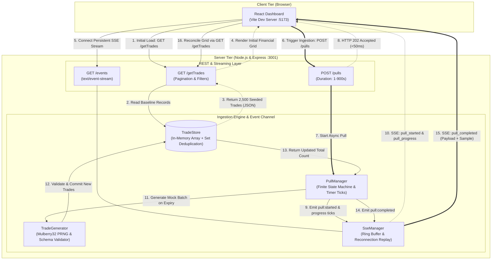

# BSE Trade Monitor

> Asynchronous Trade Ingestion Engine & Real-Time Event-Driven Dashboard
>
> **Subject**: Technical Assessment – Software Engineer

[](https://nodejs.org/)
[](https://expressjs.com/)
[](https://react.dev/)
[](https://vitejs.dev/)
[](server/test)

---

## 1. Project Overview

In production exchange integrations, pulling full historical trade datasets from the Bombay Stock Exchange (BSE) API can take up to 15 minutes (900 seconds). However, institutional network firewalls and proxy gateways enforce a hard 30-second timeout on any open HTTP connection.

This system resolves that fundamental constraint by decoupling trade pull initiation from background ingestion:
1. An initiating HTTP request returns an immediate `202 Accepted` acknowledgement in milliseconds.
2. Long-running ingestion executes independently on the server runtime.
3. When new trades are committed to storage, real-time updates are pushed to the already-open dashboard via **Server-Sent Events (SSE)**—eliminating page refreshes, client polling loops, and cron schedulers.

---

## 2. Problem Statement

### The 30-Second vs. 15-Minute Conflict

```text
[ Client Request ] ────> [ Gateway / Proxy (30s Timeout) ] ────> [ BSE API (Up to 15 min Pull) ]
                                      │
                               (After 30s)
                                      ▼
                        HTTP 504 Gateway Timeout (KILLED)
```

- **Infrastructure Limitation**: Institutional reverse proxies, NAT gateways, and load balancers forcibly terminate idle or long-running HTTP connections held open beyond 30 seconds.
- **Data Reality**: A full BSE exchange pull is voluminous and throttled, requiring up to 15 minutes (900 seconds) to complete.
- **Anti-Pattern (Synchronous Request)**: Holding an HTTP request open causes gateway timeouts, hung browsers, thread exhaustion, and total loss of downstream synchronization.
- **Anti-Pattern (Client Polling)**: Repeatedly hammering `GET /getTrades` in a timer loop wastes bandwidth, causes database/memory thrashing, introduces latency gaps, and scales poorly with multiple operators.

### Required System Behavior

1. **Immediate Dashboard Availability**: The dashboard opens instantly and renders previously pulled records from storage without waiting for any active or pending pull.
2. **Immediate Request Acknowledgement**: Triggering an ingestion pull immediately returns a confirmation token (`pullId`), releasing the client HTTP connection in under 50ms.
3. **Autonomous Background Ingestion**: Trade generation and ingestion continue reliably in the background across the entire duration (configurable from 1 to 900 seconds).
4. **Push-Based Dashboard Synchronization**: When the pull completes, new records are committed to the store and broadcast over an established SSE channel. Open dashboards receive the event and render new trades automatically without manual refreshes or polling.

---

## 3. Core Features

### Core Ingestion & Streaming Capabilities

- **Deterministic Mock BSE Trade API**: Fast `GET /getTrades` endpoint serving seeded records with schema validation, configurable limit/offset pagination, and ticker filtering.
- **Realistic Seeded Dataset**: Pre-loaded with 2,500 deterministic trades generated via Mulberry32 PRNG across major BSE equities (`RELIANCE`, `TCS`, `HDFCBANK`, `INFY`, etc.) and institutional client desks.
- **Asynchronous Pull Lifecycle Manager**: Finite-state machine managing pull transitions (`running` &rarr; `completed` | `failed`), enforcing atomic single-pull concurrency and supporting durations up to 900 seconds (15 minutes).
- **Zero-Polling Real-Time SSE Stream**: Persistent `GET /events` connection broadcasting structured lifecycle events (`pull_started`, `pull_progress`, `pull_completed`, `pull_failed`) with automatic reconnection recovery via `Last-Event-ID`.
- **Automatic Live Dashboard Updates**: React single-page interface that ingests SSE stream updates, animates incremental progress, highlights newly committed trades, and reflects updated store counts instantly.

### Dashboard & Operational Enhancements

- **Failure Isolation & Simulation**: Configurable `simulateFailure` flag enabling engineers to verify gateway timeout handling and ensure zero corrupted records are committed.
- **Dual Visual Theme System**: Instant white/black background switching with WCAG AA compliance, tabular financial typography, and localStorage persistence.
- **Connection Liveness Heartbeats**: Server-emitted SSE comments (`: heartbeat`) every 15 seconds to prevent intermediate proxy connection termination.
- **Defensive Data Immutability**: Deep defensive copying and object freezing on store reads and writes to prevent accidental in-memory state mutation.

---

## 4. Technology Stack

| Layer | Technology | Version | Purpose in Solution |
| :--- | :--- | :--- | :--- |
| **Backend Runtime** | Node.js | `v24.20.0` (ESM) | Non-blocking event-driven runtime hosting HTTP & SSE servers |
| **HTTP Framework** | Express | `^4.21.2` | REST route handling, JSON body parsing, and CORS configuration |
| **Streaming Protocol** | Server-Sent Events (SSE) | W3C Standard | Push-based unidirectional event delivery to browser clients |
| **In-Memory Store** | Native JavaScript (`Map`, `Set`, `Array`) | Native | O(1) deduplication, indexed retrieval, and pagination |
| **Frontend Framework** | React | `^19.2.8` | Declarative UI, state management, and real-time DOM reconciliation |
| **Build Tool & Dev Server**| Vite | `^8.3.0` | Fast HMR development server with built-in API proxy |
| **Test Framework** | Node Test Runner (`node:test`, `assert/strict`) | Built-in | Fast, dependency-free backend integration and unit test suite |
| **Linter** | Oxlint | `^1.81.0` | High-performance static analysis for frontend source code |

*Note: No external queues, brokers, or databases (such as Redis, Kafka, or PostgreSQL) were introduced. The architecture delivers the required guarantees within a self-contained, reproducible codebase.*

---

## 5. Architecture Overview

### Architectural Component Diagram



### Architectural Data Flows

The solution operates along two decoupled pathways:

- **Flow A (Initial Dashboard Hydration)**: The browser requests `GET /getTrades`. The server reads the existing trades from `TradeStore` and returns the paginated dataset with metadata. The dashboard renders immediately in milliseconds, completely unaffected by whether a pull is currently running or idle.
- **Flow B (Asynchronous Ingestion & Event Push)**: The operator triggers a pull via `POST /pulls`. The endpoint starts the operation in `PullManager` and returns an immediate `202 Accepted` with initial metadata within 50ms. As the background timer ticks toward the target duration (up to 15 minutes), progress events stream via `SseManager`. Upon completion, the new batch is committed to `TradeStore`, and a `pull_completed` event is broadcast. The open dashboard receives the push and reconciles its state automatically.

---

## 6. Why This Architecture?

### 1. HTTP Connection Decoupling
By replying with `202 Accepted` immediately, the HTTP request-response cycle completes in milliseconds. The 30-second network gateway timeout is never challenged, regardless of whether the pull runs for 5 seconds or the full 15 minutes (900 seconds).

### 2. Immediate Dashboard Availability
The query path (`GET /getTrades`) is decoupled from the mutation path (`POST /pulls`). Operators can view existing trades, search by ticker, and navigate pages while a 15-minute background ingestion is actively in progress.

### 3. Server-Sent Events vs. WebSockets & Polling
- **Versus Polling**: Short polling consumes server capacity, fills logs, and introduces artificial latency. Long polling risks proxy timeouts and connection drops.
- **Versus WebSockets**: WebSockets require bidirectional protocol upgrading, custom ping/pong framing, and stateful socket brokers. Because trade ingestion notifications are strictly unidirectional (server-to-client), standard HTTP SSE (`text/event-stream`) provides native browser reconnection, simple HTTP proxy traversal, and built-in `Last-Event-ID` tracking with minimal overhead.

### 4. Data Consistency & Atomic Commit
New trades are generated and validated in memory, then committed to `TradeStore` in a single synchronous operation before any completion event is emitted. If an error occurs or `simulateFailure` is triggered, zero trades are committed, leaving the pre-existing store in a clean, uncorrupted state.

### 5. Failure Isolation
If a pull fails, `PullManager` transitions to `failed` and emits `pull_failed` over SSE. Pre-existing trades remain intact and queryable. The user receives a clear visual error state without any disruption to the existing dataset.

### 6. Architectural Simplicity
For this system, introducing external distributed dependencies like Kafka, Celery, or Redis increases operational complexity and deployment friction. Utilizing Node.js's native asynchronous event loop (`EventEmitter`, `setInterval`, non-blocking timers) delivers the exact asynchronous semantics required while remaining 100% self-contained and reproducible.

---

## 7. End-to-End Request Lifecycle

```text
Operator / Browser                 Express API               PullManager & SSE               TradeStore
       │                                │                            │                           │
  1.   │── GET /getTrades ─────────────>│                            │                           │
  2.   │                                │── getTrades({limit, offset})──────────────────────────>│
  3.   │                                │<── Return 2,500 Trades ────────────────────────────────│
  4.   │<── HTTP 200 (Trades JSON) ─────│                            │                           │
  5.   │── GET /events (Connect SSE) ──>│                            │                           │
  6.   │<── HTTP 200 (text/event-stream)│<── Register Client ────────│                           │
       │                                │                            │                           │
  7.   │── POST /pulls (dur=900s) ─────>│                            │                           │
  8.   │                                │── startPull(900s) ────────>│                           │
  9.   │<── HTTP 202 Accepted (<50ms) ──│                            │                           │
       │                                                             │                           │
       │    [ Background Ingestion Continues Independently ]         │                           │
 10.   │<── SSE: pull_started ───────────────────────────────────────│                           │
 11.   │<── SSE: pull_progress (ticks every 50-500ms) ───────────────│                           │
       │                                                             │                           │
       │    [ Configured Duration Elapses ]                          │                           │
 12.   │                                                             │── addTrades(newBatch) ───>│
 13.   │                                                             │<── Commit Verified ───────│
 14.   │<── SSE: pull_completed (newTradesCount, sample) ────────────│                           │
 15.   │── GET /getTrades (Reconcile Grid) ─────────────────────────>│                           │
 16.   │<── HTTP 200 (Updated Total: 3,000) ─────────────────────────│                           │
```

1. **Dashboard Access**: The user opens the React dashboard.
2. **Initial Fetch**: The dashboard issues `GET /getTrades?limit=50&offset=0`.
3. **Data Retrieval**: `TradeStore` returns the initial 2,500 seeded records.
4. **Rendering**: The dashboard renders the financial grid and statistics cards immediately.
5. **Stream Establishment**: The dashboard opens an SSE stream via `GET /events`.
6. **Handshake**: The server registers the client and returns a `connected` handshake event.
7. **Pull Trigger**: The user configures a pull duration (e.g., 5s, 60s, or 900s) and clicks **Pull Trades**.
8. **Asynchronous Hand-off**: Express validates parameters and invokes `pullManager.startPull()`.
9. **Immediate Acknowledgement**: The server returns `202 Accepted` with the new `pullId` within ~50ms.
10. **Lifecycle Broadcast**: `SseManager` broadcasts `pull_started` to all active clients.
11. **Progress Monitoring**: As the background timer ticks, `pull_progress` events stream to the dashboard progress bar.
12. **Batch Generation & Commit**: When duration expires, `tradeGenerator` creates validated records and appends them to `TradeStore`.
13. **Completion Broadcast**: `SseManager` broadcasts `pull_completed` containing summary statistics and a sample of newly ingested trades.
14. **Dashboard Reconciliation**: The open dashboard receives `pull_completed`, highlights newly ingested records, and updates the grid without a page refresh or polling loop.

---

## 8. Repository Structure

```text
real-time-trade-monitor/
├── .gitignore                      # Git exclusion rules (node_modules, .env, dist, logs)
├── README.md                       # Architectural specification and engineering documentation
├── client/                         # Frontend React Single-Page Application
│   ├── .gitignore                  # Client-level build artifact exclusions
│   ├── .oxlintrc.json              # Oxlint static analysis configuration
│   ├── index.html                  # HTML entry point with theme bootstrap script
│   ├── package.json                # React 19, Vite, and Oxlint dependencies
│   ├── vite.config.js              # Vite dev server configuration and backend reverse proxy
│   └── src/
│       ├── App.css                 # Financial dashboard design system and theme styles
│       ├── App.jsx                 # Dashboard root container and layout composition
│       ├── index.css               # Core CSS variables, typography, and dark/light tokens
│       ├── main.jsx                # React application bootstrap
│       ├── components/
│       │   ├── Header.jsx          # Top bar with SSE status badge and theme toggle
│       │   ├── PullControls.jsx    # Ingestion controls (duration, record count, failure toggle)
│       │   ├── StatsOverview.jsx   # Institutional metric cards (total trades, sync time, active pull)
│       │   └── TradeTable.jsx      # Paginated financial table with symbol search & highlighting
│       ├── hooks/
│       │   ├── useTheme.js         # Custom hook managing persistent dark/light theme state
│       │   └── useTradeDashboard.js# Core hook orchestrating API calls, SSE lifecycle, and pagination
│       └── services/
│           ├── api.js              # HTTP client for /getTrades and /pulls REST endpoints
│           └── sseClient.js        # EventSource wrapper managing SSE connection and event dispatch
└── server/                         # Backend Express REST API & SSE Event Stream
    ├── package.json                # Express and CORS dependencies, start/dev scripts
    ├── src/
    │   ├── app.js                  # Express application setup, middleware, and route mounting
    │   ├── index.js                # Server entry point listening on port 3001
    │   ├── models/
    │   │   └── tradeModel.js       # BSE trade schema definition, validator, and factory
    │   ├── routes/
    │   │   ├── eventRoutes.js      # GET /events SSE endpoint and /events/stats diagnostic route
    │   │   ├── pullRoutes.js       # POST /pulls trigger, GET /pulls, and GET /pulls/:id routes
    │   │   └── tradeRoutes.js      # GET /getTrades endpoint with pagination and ticker filtering
    │   └── services/
    │       ├── pullManager.js      # Asynchronous pull lifecycle manager and finite-state coordinator
    │       ├── sseManager.js       # SSE client manager, 100-event ring buffer, and replay handler
    │       ├── tradeGenerator.js   # Deterministic Mulberry32 PRNG mock BSE trade generator
    │       └── tradeStore.js       # In-memory trade store with Set-based O(1) deduplication
    └── test/                       # Node.js Test Runner integration test suites
        ├── pullLifecycle.test.js   # 8 tests: async execution, 202 status, 409 conflict, failure isolation
        ├── sseEvents.test.js       # 8 tests: SSE headers, monotonic IDs, broadcast, replay, heartbeats
        ├── tradeApi.test.js        # 11 tests: /getTrades pagination, symbol filters, parameter validation
        └── tradeGenerator.test.js  # 11 tests: schema validation, PRNG determinism, and performance budget
```

---

## 9. API Reference

All routes are mounted at the root path (`/`) and aliased under `/api` for convenience.

### 1. `GET /getTrades`

Retrieve paginated mock BSE trade records from the store.

- **Method**: `GET`
- **Path**: `/getTrades` (or `/api/getTrades`)
- **Query Parameters**:
  - `limit` *(optional, integer)*: Number of records to return. Range: `1` to `5000`. Default: `2500`.
  - `offset` *(optional, integer)*: Pagination offset. Range: `>= 0`. Default: `0`.
  - `symbol` *(optional, string)*: Filter by uppercase BSE ticker symbol (e.g., `RELIANCE`, `TCS`).
- **Success Status**: `200 OK`
- **Response Example**:
  ```json
  {
    "success": true,
    "count": 2,
    "total": 2500,
    "data": [
      {
        "tradeId": "BSE-MOCK-000001",
        "client": "Arham Capital Management",
        "symbol": "RELIANCE",
        "quantity": 100,
        "price": 2854.50,
        "timestamp": "2026-10-16T09:15:00.000Z",
        "isMock": true
      },
      {
        "tradeId": "BSE-MOCK-000002",
        "client": "Kotak Institutional Equities",
        "symbol": "TCS",
        "quantity": 25,
        "price": 3942.10,
        "timestamp": "2026-10-16T09:15:05.000Z",
        "isMock": true
      }
    ],
    "metadata": {
      "isMock": true,
      "source": "BSE_SIMULATOR",
      "timestamp": "2026-10-17T17:30:00.000Z"
    }
  }
  ```
- **Error Behavior**: Returns `400 Bad Request` if `limit`, `offset`, or `symbol` fail validation.

---

### 2. `POST /pulls`

Initiate an asynchronous mock BSE trade pull. Returns immediately with an acknowledgement token; work executes in the background.

- **Method**: `POST`
- **Path**: `/pulls` (or `/api/pulls`)
- **Headers**: `Content-Type: application/json`
- **Request Body (JSON, optional)**:
  - `durationSeconds` *(optional, integer)*: Total pull duration in seconds. Range: `1` to `900` (up to 15 minutes). Default: `5`.
  - `recordCount` *(optional, integer)*: Number of new trades to generate. Range: `1` to `5000`. Default: `500`.
  - `simulateFailure` *(optional, boolean)*: When `true`, simulates an exchange gateway timeout without committing trades. Default: `false`.
- **Success Status**: `202 Accepted`
- **Response Example**:
  ```json
  {
    "success": true,
    "message": "BSE trade pull operation initiated",
    "pull": {
      "pullId": "PULL-1729186200000-X7K2A",
      "status": "running",
      "startedAt": "2026-10-17T17:30:00.000Z",
      "completedAt": null,
      "failedAt": null,
      "durationSeconds": 5,
      "recordCount": 500,
      "progress": 0,
      "recordsRetrieved": 0,
      "totalTradesInStore": 2500,
      "error": null,
      "isMock": true
    }
  }
  ```
- **Error Behavior**:
  - `400 Bad Request`: Invalid parameter types or values outside allowable bounds.
  - `409 Conflict`: Returned if another pull operation is currently `running`. Includes the `activePull` metadata in the response.

---

### 3. `GET /pulls/:id`

Retrieve the current status, progress, and execution details of a specific pull operation.

- **Method**: `GET`
- **Path**: `/pulls/:id` (or `/api/pulls/:id`)
- **Success Status**: `200 OK`
- **Response Example**:
  ```json
  {
    "success": true,
    "pull": {
      "pullId": "PULL-1729186200000-X7K2A",
      "status": "completed",
      "startedAt": "2026-10-17T17:30:00.000Z",
      "completedAt": "2026-10-17T17:30:05.120Z",
      "failedAt": null,
      "durationSeconds": 5,
      "recordCount": 500,
      "progress": 100,
      "recordsRetrieved": 500,
      "totalTradesInStore": 3000,
      "error": null,
      "isMock": true
    }
  }
  ```
- **Error Behavior**: Returns `404 Not Found` if the requested `pullId` does not exist in memory or recent history.

---

### 4. `GET /pulls`

Retrieve the currently running pull (if any) and recent pull execution history.

- **Method**: `GET`
- **Path**: `/pulls` (or `/api/pulls`)
- **Success Status**: `200 OK`
- **Response Example**:
  ```json
  {
    "success": true,
    "activePull": null,
    "recentPulls": [
      {
        "pullId": "PULL-1729186200000-X7K2A",
        "status": "completed",
        "durationSeconds": 5,
        "recordCount": 500,
        "progress": 100
      }
    ]
  }
  ```

---

### 5. `GET /events`

Real-time Server-Sent Events (SSE) streaming channel for trade pull lifecycle updates.

- **Method**: `GET`
- **Path**: `/events` (or `/api/events`)
- **Response Headers**:
  - `Content-Type: text/event-stream`
  - `Cache-Control: no-cache, no-transform`
  - `Connection: keep-alive`
- **Supported Request Headers**:
  - `Last-Event-ID`: Monotonic integer sequence ID used by reconnecting clients to replay missed events from the 100-event ring buffer.
- **Event Types Emitted**:
  - `connected`: Handshake event delivering assigned `clientId`, `serverTime`, and current `activePull` status.
  - `pull_started`: Emitted immediately when a new pull transitions to `running`.
  - `pull_progress`: Emitted periodically with `{ pullId, progress, elapsedSeconds }`.
  - `pull_completed`: Emitted upon successful trade commitment with `{ pull, newTradesCount, totalTradesInStore, recentTradesSample }`.
  - `pull_failed`: Emitted if a pull fails or simulates a gateway error with `{ pull }`.
  - `sync_required`: Emitted if a reconnecting client's `Last-Event-ID` has expired beyond the ring buffer, signaling the client to perform a baseline refresh via `GET /getTrades`.
  - `: heartbeat`: Comment line sent every 15 seconds to prevent intermediate proxy timeout.

---

### 6. `GET /api/health`

Diagnostic liveness probe.

- **Method**: `GET`
- **Path**: `/api/health`
- **Success Status**: `200 OK`
- **Response Example**:
  ```json
  {
    "status": "ok",
    "service": "Arham Mock BSE Trade Engine",
    "timestamp": "2026-10-17T17:30:00.000Z"
  }
  ```

---

## 10. Local Setup and Execution

### Prerequisites

- **Node.js**: `v20.0.0` or higher (tested on `v24.20.0`)
- **npm**: `v10.0.0` or higher (tested on `11.19.0`)
- **Shell**: PowerShell (Windows) or standard Unix terminal (macOS/Linux)

---

### Step 1 — Start the Backend Server

Open a terminal window and execute:

```powershell
# Navigate to server directory
cd server

# Install backend dependencies (Express, CORS)
npm install

# Start backend server in development watch mode
npm run dev
```

- **Server URL**: `http://localhost:3001`
- **Health Check**: `http://localhost:3001/api/health`

---

### Step 2 — Start the Frontend Client

Open a second terminal window and execute:

```powershell
# Navigate to client directory
cd client

# Install frontend dependencies (React 19, Vite, Oxlint)
npm install

# Start Vite development server
npm run dev
```

- **Dashboard URL**: `http://localhost:5173`
- **Vite Proxy**: Automatically proxies `/getTrades`, `/pulls`, `/events`, and `/api` requests to `http://localhost:3001`.

---

## 11. Testing and Verification

The project includes an automated backend integration test suite built with Node.js's native test runner (`node:test` and `node:assert/strict`).

### Run Backend Integration Tests

Open a terminal window and execute:

```powershell
# Navigate to server directory
cd server

node --test test/*.test.js
```

### Verified Test Results

All **38 integration and unit tests pass** across 5 test suites:

```text
▶ Asynchronous Pull Lifecycle Integration Tests
  ✔ should immediately return HTTP 202 Accepted on POST /pulls with pull metadata (491ms)
  ✔ should complete asynchronously and commit newly generated trades to store (1435ms)
  ✔ should atomically reject concurrent start requests with HTTP 409 Conflict (25ms)
  ✔ should reject invalid input parameters with HTTP 400 (128ms)
  ✔ should return HTTP 404 for unknown pull IDs (26ms)
  ✔ should transition to failed on simulateFailure: true and publish zero trades (1432ms)
  ✔ should support full 15-minute (900s) configuration returning immediately without waiting (43ms)
  ✔ should emit structured EventEmitter lifecycle events (1339ms)
✔ Asynchronous Pull Lifecycle Integration Tests (4979ms)

▶ Server-Sent Events (SSE) Channel Integration Tests
  ✔ should establish SSE connection with correct standard headers and handshake event (156ms)
  ✔ should deliver monotonically increasing event IDs across broadcasts (54ms)
  ✔ should fan-out broadcast events to multiple concurrently connected clients (59ms)
  ✔ should stream pull lifecycle events (start, progress, completion) during active pull (1270ms)
  ✔ should clean up client registration immediately on socket close (179ms)
  ✔ should replay missed events in ascending order when reconnecting with Last-Event-ID (37ms)
  ✔ should send sync_required event when Last-Event-ID is invalid or expired beyond buffer (30ms)
  ✔ should transmit heartbeat comments to maintain socket liveness (37ms)
✔ Server-Sent Events (SSE) Channel Integration Tests (1859ms)

▶ GET /getTrades Integration Tests
  ✔ should return 200 and default 2500 seeded trades with valid metadata (148ms)
  ✔ should guarantee all returned trade IDs are unique (29ms)
  ✔ should support pagination via limit and offset (53ms)
  ✔ should filter trades by symbol accurately (8ms)
  ✔ should return empty data array when symbol does not match any trade (10ms)
  ✔ should reject invalid limit parameter with HTTP 400 (93ms)
  ✔ should reject invalid offset parameter with HTTP 400 (14ms)
  ✔ should reject malformed symbol with HTTP 400 (32ms)
  ✔ should ensure store immutability when returned objects are modified (31ms)
  ✔ should also respond successfully on /api/getTrades alias (15ms)
  ✔ should respond to /api/health with HTTP 200 (16ms)
✔ GET /getTrades Integration Tests (500ms)

▶ Trade Model and Validator
  ✔ should validate a properly structured trade (1ms)
  ✔ should reject invalid or negative quantity (0.4ms)
  ✔ should reject invalid or non-positive price (0.2ms)
  ✔ should reject invalid timestamp (0.2ms)
  ✔ should reject trade where isMock is not true (0.1ms)
  ✔ should reject malformed tradeId format (0.2ms)
✔ Trade Model and Validator (4ms)

▶ Deterministic Mock Trade Generator
  ✔ should generate identical datasets given the same seed and parameters (5.8ms)
  ✔ should generate different datasets when given different seeds (0.6ms)
  ✔ should generate records where every tradeId is unique (9ms)
  ✔ should ensure all 2500 generated records pass strict schema validation (10ms)
  ✔ should generate 2500 records efficiently within performance budget (< 100ms) (8ms)
✔ Deterministic Mock Trade Generator (35ms)

ℹ tests 38 | suites 5 | pass 38 | fail 0 | cancelled 0 | skipped 0 | todo 0
```

---

### Run Frontend Static Analysis

```powershell
# Navigate to client directory
cd client

npm run lint
```

- **Result**: `0 warnings and 0 errors across 11 files with 104 rules`.

---

## 12. Trade-Offs and Limitations

Engineering decisions in this prototype prioritize clarity, zero external infrastructure dependencies, and verifiable correctness:

### 1. In-Memory Store & Volatile State
- **Implementation**: Trades and pull history reside in memory (`TradeStore` array and `Set`).
- **Trade-Off**: Restarting the Node.js process resets trade records to the initial 2,500 seeded trades and cancels any active pull.
- **Production Path**: In an enterprise deployment, active pull metadata would be coordinated through a distributed cache/state store (e.g., Redis or PostgreSQL), and trade records would be written to a time-series or relational database (e.g., PostgreSQL / TimescaleDB).

### 2. Single-Process Concurrency Limit
- **Implementation**: Concurrency is managed atomically in-memory via `PullManager.activePull`, returning `409 Conflict` if a second pull is requested while one is running.
- **Trade-Off**: Horizontal scaling across multiple Node.js cluster processes would require a distributed lock (e.g., Redlock or database row locks) to prevent concurrent pulls across nodes.

### 3. Bounded Event Replay Buffer
- **Implementation**: `SseManager` maintains a circular in-memory buffer of the last 100 events for `Last-Event-ID` replay.
- **Trade-Off**: If a client experiences network disruption lasting longer than 100 broadcast events, the buffer expires and emits `sync_required`, triggering a full baseline re-fetch via `GET /getTrades`.

---

## 13. Video Walkthrough Script & Demonstration Guide

This concise ~2-minute script is designed for recording the video walkthrough directly on screen:

### Walkthrough Script (2–3 Minutes)

- **[0:00 – 0:30] The Core Constraint & Architecture**:
  > *"This demonstration presents the BSE Trade Monitor. In real exchange scenarios, pulling a full historical dataset from the BSE API can take up to 15 minutes, but network proxies terminate HTTP connections held open beyond 30 seconds. To solve this, our backend decouples the request: when an ingestion pull is triggered, it responds with an immediate `202 Accepted` in milliseconds, executes the long-running job in the background, and pushes completion updates to the dashboard via Server-Sent Events—with zero client polling."*

- **[0:30 – 1:00] Instant Dashboard Hydration**:
  > *"When the dashboard loads at `localhost:5173`, it hydrates instantly with our 2,500 seeded baseline mock trades from `GET /getTrades`. The UI is fully interactive—we can filter by ticker (such as `RELIANCE`), paginate through records, and toggle between dark and light themes without waiting on any backend ingestion state."*

- **[1:00 – 1:40] Immediate 202 Acknowledgement & Background Execution**:
  > *"With browser DevTools open on the Network tab, I'll trigger a new pull configured for 10 seconds. Notice that `POST /pulls` acknowledges immediately with `202 Accepted` in under 50 milliseconds—well beneath the 30-second proxy limit. While the job runs in the background, the UI remains responsive, and live progress ticks stream to the dashboard progress bar over our `/events` SSE channel."*

- **[1:40 – 2:15] Push-Based Completion & Zero Polling**:
  > *"Without manual page refreshes or background polling requests in DevTools, as soon as the background timer finishes, the server commits 500 new trades to the store and emits `pull_completed`. The open dashboard captures this event, increments the total count to 3,000, and highlights the newly ingested trade rows in green."*

- **[2:15 – 2:40] Failure Isolation & Automated Tests**:
  > *"Checking 'Simulate BSE Gateway Failure' verifies failure isolation: the server emits `pull_failed`, the dashboard displays the error cleanly, and zero corrupted trades are written to the store. Finally, running `node --test test/*.test.js` executes our 38 automated backend integration tests covering the pull lifecycle, SSE replay, and schema validation—all 38 pass cleanly."*

### Recording Checklist

1. [ ] Open terminal 1 and start backend: `cd server; npm run dev`.
2. [ ] Open terminal 2 and start frontend: `cd client; npm run dev`.
3. [ ] Open browser to `http://localhost:5173` with DevTools Network tab visible.
4. [ ] Demonstrate instant initial load (2,500 trades).
5. [ ] Trigger a pull (e.g., 10 seconds), showing immediate `202 Accepted` response.
6. [ ] Show real-time progress bar advancing via SSE without UI freezing.
7. [ ] Show automatic update upon completion (new total: 3,000, green highlighted rows).
8. [ ] Demonstrate failure isolation with the simulate failure toggle.
9. [ ] Run `node --test test/*.test.js` in terminal to show 38 passing tests.

> **Walkthrough Video Link**: `[Video Walkthrough Link — To be inserted upon recording]`

---

## 14. Assessment Deliverables

- [x] **Git Repository & Setup Instructions**: Fully configured, self-contained repository with verified PowerShell setup and start commands.
- [x] **Architecture Note & Diagram**: Complete component and data-flow diagrams explaining the 30-second timeout vs. 15-minute pull decoupled design (Sections 5 & 6).
- [x] **Automated Test Suite**: 38 integration and unit tests passing natively with Node Test Runner (`node:test`).
- [ ] **Video Walkthrough**: Step-by-step recording sequence and natural script prepared above; video recording to be attached upon completion.

---

## Repository

- **GitHub Repository**: [https://github.com/vishalsahanipvppcoe/real-time-trade-monitor](https://github.com/vishalsahanipvppcoe/real-time-trade-monitor)
- **Branch**: `main`